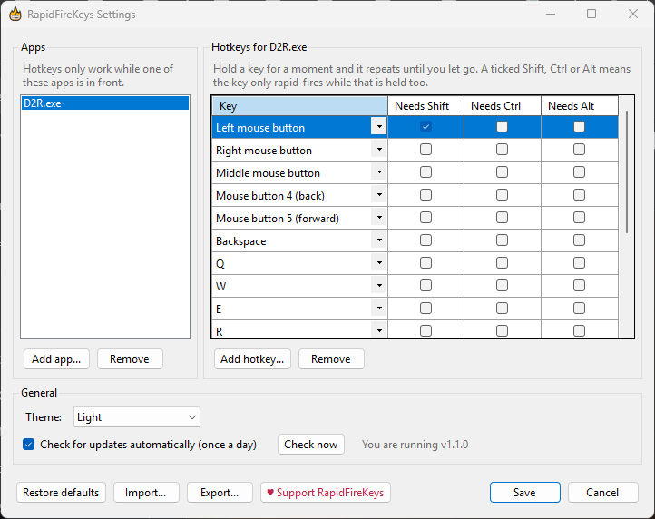
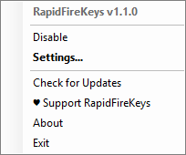
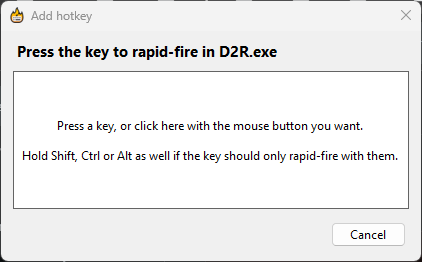
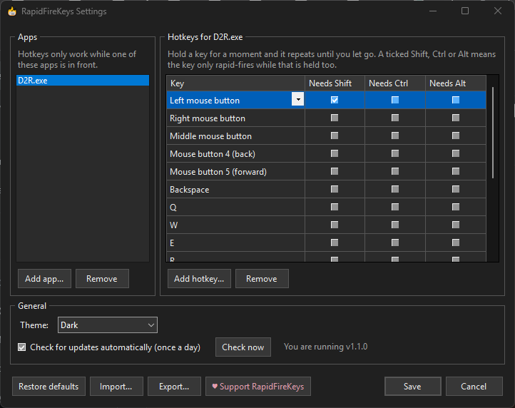
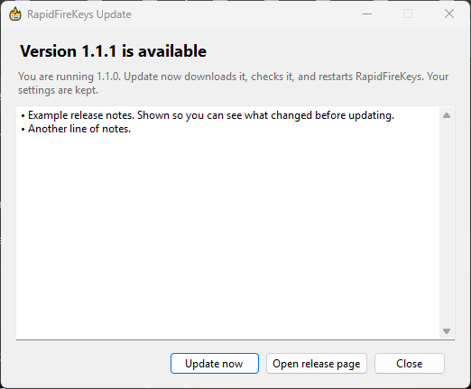

# RapidFireKeys

**Hold a key, and RapidFireKeys presses it for you — over and over, only in the apps you choose.**

A small Windows tray app built for Diablo II: Resurrected. In D2R, holding a skill
key while your cursor is over an item or object stops the skill from casting, so
you end up button-mashing to keep it going. RapidFireKeys does the mashing: hold
the key down and it keeps firing until you let go.

[](https://github.com/levinium/RapidFireKeys/releases/latest)
[](https://github.com/levinium/RapidFireKeys/releases)

[](https://github.com/sponsors/levinium)



## Download

**[Download RapidFireKeys.exe](https://github.com/levinium/RapidFireKeys/releases/latest/download/RapidFireKeys.exe)** (latest release, 69 MB)

Put `RapidFireKeys.exe` in a folder of its own and run it. That is the whole
installation: it is a single self-contained file with the .NET runtime built in,
so nothing else needs to be installed. Settings live in
`%AppData%\RapidFireKeys`; delete that folder and the exe to remove it
completely. You need 64-bit Windows.

Windows SmartScreen will warn that the app is unsigned. Choose **More info**
then **Run anyway**, or read the source and build it yourself. A `.sha256` is
published beside each release so you can confirm you have the file the release
workflow built.

Windows will also show a **UAC prompt** every time it starts. RapidFireKeys
always runs as administrator, because Windows blocks simulated key presses from
a normal app to an app running elevated — and games often run elevated. If you
would rather not confirm UAC on every launch, create a Task Scheduler task for
`RapidFireKeys.exe` with **Run with highest privileges** ticked and launch the
app from that task (for example with a shortcut to `schtasks /run /tn RapidFireKeys`).

---

### If it saves your fingers some button-mashing

RapidFireKeys is free and open source, and will stay that way — no paid
version, no nag screens, nothing held back.

If it has earned a place in your tray, you can put something toward keeping it
working after the next game patch.

[](https://github.com/sponsors/levinium)

Not at all expected. Starring the repo, or pointing a friend at it, helps just
as much.

---

## Getting started



1. Run `RapidFireKeys.exe` and accept the UAC prompt. A flame icon appears in
   the system tray.
2. That's it for D2R: it comes set up for `D2R.exe` with the usual skill keys
   (see [the defaults](#the-defaults)). Start the game, hold a skill key, and
   it keeps casting.
3. To change anything, **double-click the tray icon** (or right-click it and
   choose **Settings...**).

RapidFireKeys only does anything while one of your configured apps is the
window in front. Everywhere else your keys behave normally.

## What it does

### You choose the apps and the keys



The Settings window lists the apps on the left and that app's hotkeys on the
right.

- **Add app...** offers the programs running right now, or you can type an
  `.exe` name. Use it for any game with the same hold-to-repeat problem.
- **Add hotkey...** asks you to press the key, or click the mouse button,
  you want rapid-fired. Hold Shift, Ctrl or Alt at the same time and the hotkey
  will only rapid-fire while that modifier is held too.
- Every hotkey can be changed in place: pick a different key from the list, or
  tick **Needs Shift / Needs Ctrl / Needs Alt**.
- **Restore defaults** puts back the original D2R setup.
- **Import... / Export...** move your setup to and from a file (see
  [Your settings](#your-settings-and-moving-them)).

Nothing changes until you press **Save**, and saving takes effect immediately —
no restart. **Cancel** discards everything since the window opened. A key that
is held at the moment you remove it stops firing.

Supported keys are the mouse buttons (left, right, middle, back, forward),
letters, the number row, the numpad, F1–F12, arrows, Space, Enter, Tab,
Backspace, Escape, Insert/Delete/Home/End/Page Up/Page Down, and Shift, Ctrl
and Alt themselves. Not every key has been tested in every game.

### Light or dark, following Windows



Every window and the tray menu come in light and dark. By default RapidFireKeys
follows Windows' own app setting (Settings → Personalization → Colors), and
switches along with it while running. **Theme** in Settings can pin it to Light
or Dark instead; the choice previews immediately and Cancel puts it back.

### It only fires keys you are physically holding

RapidFireKeys watches your real keyboard and mouse and ignores input sent by
other software, so automation tools or macros cannot set it off. Rapid-fire
stops as soon as you let go, release a required modifier, or switch to a
different window — even another copy of the same game.

`%AppData%\RapidFireKeys\RapidFireKeys.log` records when each rapid-fire starts and
stops, which helps track down a misfire.

### It keeps itself up to date



Once a day RapidFireKeys checks whether a newer version has been published.
When one has, a notification pops up from the tray icon and **Update to …**
appears at the top of the tray menu. Click either to see what changed; press
**Update now** and it downloads the new exe, checks it against the checksum
GitHub recorded for it, swaps it in and restarts — still elevated, with no
second UAC prompt. Your settings are kept.

A failed update costs nothing but the download: nothing is replaced until the
new file has been fully downloaded and verified, and a download that does not
match its checksum is discarded. Nothing is ever installed without you pressing
the button.

**Check for Updates** in the tray menu (or **Check now** in Settings) asks on
demand, and the daily check can be turned off in Settings. It sends no
identifier and nothing about your machine, apps or hotkeys — it is a plain
request for a public file.

> Automatic updates start with 1.1.0. If you are on 1.0.5 or earlier, download
> 1.1.0 by hand once and replace your old exe; your CONFIG.json is imported.

## The defaults

Out of the box, RapidFireKeys rapid-fires these in `D2R.exe`:

| Key | Fires when |
| --- | --- |
| Left mouse button | held **with Shift** (so ordinary clicking and walking are unaffected) |
| Right, middle, back and forward mouse buttons | held |
| Backspace, Q, W, E, R, A, S, D, F, G, H, B | held |

## Your settings, and moving them

Everything RapidFireKeys remembers — apps, hotkeys, theme, the update check —
is in one file, `%AppData%\RapidFireKeys\settings.json`, beside its log. The
Settings window is the place to change it.

- **Export...** saves what is on screen to a file of your choosing: a backup,
  or a way to take your setup to another PC.
- **Import...** loads an exported file into the window. It also accepts a
  `CONFIG.json` from RapidFireKeys 1.0.x. As with any other change, nothing is
  kept until you press **Save**, and **Cancel** discards it.

Upgrading from 1.0.x? On first run, 1.1.0 imports the `CONFIG.json` next to
the exe automatically. That file is left where it is but no longer used.

## Removing it

Choose **Exit** from the tray menu, delete `RapidFireKeys.exe`, and delete
`%AppData%\RapidFireKeys` if you don't want to keep your settings. Nothing was
installed anywhere else: no registry entries, no services, no startup items.

## A word of warning

Some online games detect "auto presses" and ban players for macroing. Whether
this is detectable is unknown. It has been used for a long time online in
Diablo II: Resurrected without issues, but there is no guarantee Blizzard or
anyone else won't decide otherwise. **Use it at your own risk.**

## The Support menu item

Release builds carry a **♥ Support RapidFireKeys** item in the tray menu and a
button in Settings; a build from a clean checkout does not. The destination is
a build property, empty in this repository, and with nothing set the item does
not appear at all — so a fork ships no ask, and there is nothing to remember to
strip out.

## Building from source

Needs the .NET 8 SDK.

```powershell
dotnet build RapidFireKeys\RapidFireKeys.sln -c Release
dotnet test  RapidFireKeys\RapidFireKeys.sln -c Release   # 106 tests
```

The tests cover the parts that fail quietly rather than loudly: reading
hand-written configs, writing back exactly what Settings showed, whether a
published version is newer than the one running, and whether a download
matches its checksum.

To build the release exe — self-contained, single file:

```powershell
.\publish.ps1
.\publish.ps1 -SponsorUrl "https://github.com/sponsors/<user>?frequency=one-time&amount={amount}"
```

`publish.ps1` runs the tests first and refuses to publish if any fail. An
`{amount}` placeholder turns the support dialog into a picker — $3 / $5 / $10 /
$25 or another whole amount — with the chosen sum substituted into the link.

Releases themselves are built by GitHub Actions: pushing a `v*` tag checks that
the tag matches `<Version>` in the csproj, runs the tests, publishes the exe
with a SHA-256 beside it, and opens a draft release to look over before anyone
can download it (or be offered it by the updater).

## How it is put together

```
RapidFireKeys\
├── RapidFireKeys\
│   ├── Form1.cs              Tray icon, menu, and the loop that watches held keys
│   ├── PhysicalInput.cs      Low-level hooks: which keys are physically held
│   ├── HotkeyConfig.cs       Reads and compiles hotkey lists
│   ├── Preferences.cs        The settings file in %AppData%, import/export, 1.0.x migration
│   ├── Theme.cs              Light/dark colors for every window and the tray menu
│   ├── SponsorLink.cs        Where the support button goes, if anywhere
│   ├── Views\
│   │   ├── SettingsForm.cs   Apps and hotkeys editor
│   │   ├── CaptureKeyForm.cs "Press the key to rapid-fire"
│   │   ├── AddAppForm.cs     Pick a running program or type an .exe
│   │   ├── UpdateForm.cs     Release notes and Update now
│   │   └── SponsorForm.cs    The support dialog
│   └── Updates\
│       ├── UpdateService.cs  Reads the releases feed
│       ├── UpdateInstaller.cs Downloads, verifies and swaps in the new exe
│       └── ...               Version comparison, schedule, release notes
└── RapidFireKeys.Tests\
```

The core is one loop: every 10 ms it checks which app is in front, and for each
of that app's hotkeys whether the key is held. A key counts as held only when
Windows reports it down **and** the low-level hooks in `PhysicalInput` saw a
physical press, which is what keeps keys sent by other software from setting it
off. Once a key has been held for about 200 ms it is re-sent every 50 ms, half down
and half up, posted straight to the foreground window, until it is released,
its modifier is let go, or the window changes.

Hotkeys reach that loop as one compiled snapshot that Settings swaps in whole on
Save, so the loop never sees half of an edit.

## Version history

See [CHANGELOG.md](CHANGELOG.md).

## Third-party components

| Component | License | Used for |
| --- | --- | --- |
| .NET 8 / Windows Forms | MIT | the app itself, bundled into the single exe |
| [xUnit](https://xunit.net) | Apache 2.0 | tests only |
| [Shouldly](https://github.com/shouldly/shouldly) | BSD-3-Clause | tests only |

Diablo II: Resurrected is a trademark of Blizzard Entertainment. This is an
unofficial tool and is not affiliated with or endorsed by Blizzard.
